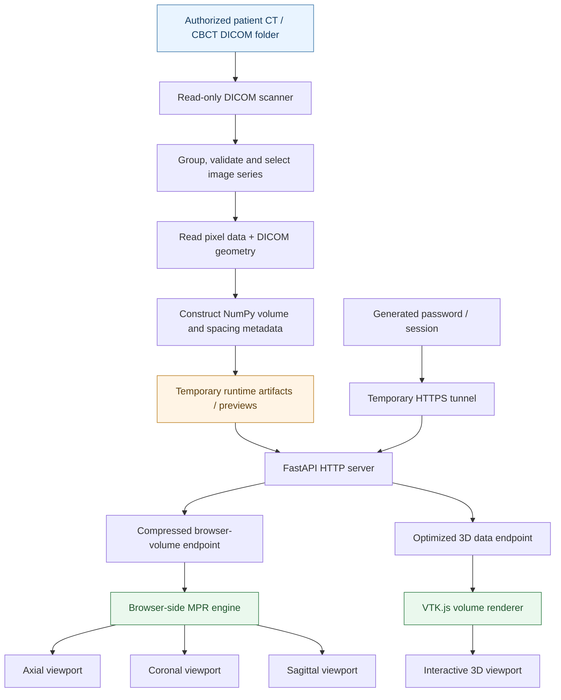
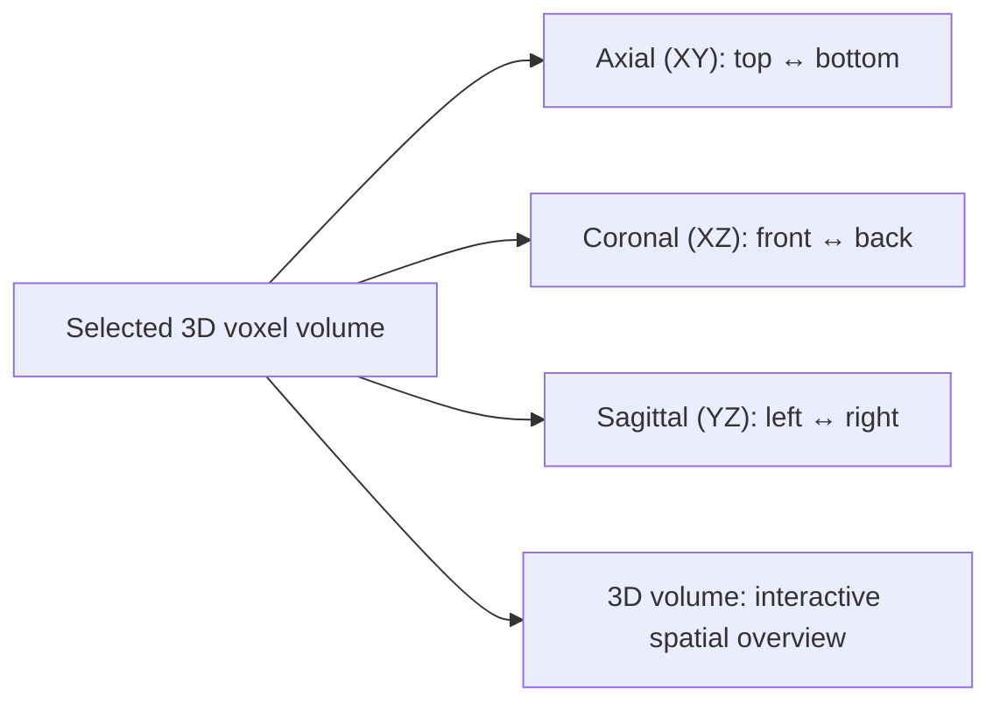

<div align="center">

# 🦷 Sinus 3D Viewer Pro
### Browser-Based CT/CBCT DICOM Visualization with Smooth Multiplanar Reconstruction and Interactive 3D Rendering

**A privacy-conscious, read-only medical imaging viewer for exploring sinus CT and cone-beam CT studies using axial, coronal, sagittal and volumetric views.**


[Overview](#-project-overview) · [Architecture](#-system-architecture) · [Features](#-features) · [Installation](#-running-the-project) · [Results](#-results-and-current-status) · [Screenshots](#-screenshots)

</div>

> [!IMPORTANT]
> **Research and visualization software, not a certified diagnostic medical device.** It must not be used as the sole basis for clinical decisions. Patient-identifying DICOM files, access links, credentials, and unredacted screenshots must never be committed to a public repository.

## 📖 Project Overview

**Sinus 3D Viewer Pro** is a web-based medical-image visualization project designed to make large CT/CBCT DICOM series easier to inspect through a browser. It combines a Python medical-imaging backend with a web user interface and a working **Google Colab one-cell launcher**. The viewer supports three orthogonal *multiplanar reconstruction* (MPR) planes—**axial, coronal and sagittal**—alongside an interactive **3D volume** view.

The uploaded project contains **two related execution paths**:

1. **Colab viewer (demonstrated working workflow):** a one-cell notebook scans an authorized DICOM folder, prepares temporary visualization artifacts, launches a FastAPI server, serves browser-resident MPR and interactive VTK.js rendering, and creates a temporary HTTPS link.
2. **Modular full-stack application (source architecture):** a React/TypeScript/Vite frontend and FastAPI backend with modules for dataset browsing, volume services, security, DICOM decoding, viewing controls and measurements. Some modules are intentionally empty placeholders in the supplied source; this track must not be described as fully production-complete.

### The central idea

Instead of requesting a new image from the server every time the mouse wheel moves, an optimized browser-resident MPR strategy can deliver volume data once and perform slice navigation directly inside the browser. This reduces dependence on round-trip network latency during scrolling while retaining a separate, optimized 3D rendering path.

## 🎯 Problem Statement

High-resolution sinus CT/CBCT studies often contain hundreds of DICOM slices. Reviewing them can be inconvenient when:
- users need to install specialized desktop software;
- remote viewers request individual slices continuously, resulting in choppy mouse-wheel scrolling;
- large volumes demand substantial memory, transfer time and preprocessing;
- low-quality interpolation makes anatomy appear blurry;
- axial, coronal, sagittal and 3D views are separated across interfaces;
- medical data must be handled without changing the original studies.

### Project objectives

| Objective | Project approach |
|---|---|
| Explore real DICOM studies | Scan and select a consistent image series from an authorized folder |
| Preserve source data | Read-only input workflow; generated files belong in temporary/runtime locations |
| Three-plane inspection | Axial, coronal and sagittal reconstruction |
| Volume understanding | Interactive VTK.js 3D rendering |
| Smooth interaction | Browser-resident MPR / local slice navigation |
| Efficient transfer | Compressed volume delivery and an optimized 3D representation |
| Accessible demo | Colab launcher + temporary HTTPS access |
| Safer session handling | Generated session credentials and password-protected access in the Colab path |

## ✨ Features

### Implemented in the Colab viewer path
- **Smart DICOM scan and series selection** for a patient/study folder.
- **Read-only source handling**; derived artifacts are generated in a separate runtime directory.
- **Three orthogonal MPR views**: axial, coronal, sagittal.
- **Interactive 3D volume** with VTK.js.
- **Mouse wheel navigation**, with a browser-side MPR optimization to reduce per-slice server requests.
- **Window/level conversion and rendering controls** to inspect intensity ranges.
- **Physical aspect-ratio awareness** using voxel-spacing metadata.
- **Previews**, volume metadata and serialized visualization data.
- **Compressed browser-volume delivery**, improving transfer efficiency relative to an uncompressed payload.
- **Temporary FastAPI server + Cloudflare tunnel** with session/password handling.
- **Single-cell restart workflow** after Colab runtime setup; the temporary URL is session-bound.

### Present in the modular codebase
The React app and FastAPI code include implementations or modules for dataset browsing, previews, MPR canvases and viewports, crosshairs, slice sliders, window-level controls, orientation labels, measurements, scale bars, API clients, DICOM scanning/decoding, volume building, caching and security. **Not all of these components have been validated together in an end-to-end deployment.** Some associated routes, tests, docs and scaffolding files are empty in the uploaded archive.

## 🏗️ System Architecture



### How a DICOM study becomes a browser-rendered volume

```mermaid
sequenceDiagram
    autonumber
    actor U as User
    participant N as Colab Notebook
    participant D as Read-only DICOM Folder
    participant API as FastAPI
    participant B as Browser
    U->>N: Paste authorized patient folder path
    N->>D: Scan and inspect series
    D-->>N: Headers, slices and geometry
    N->>N: Decode / organize volume; create runtime files
    N->>API: Start server and endpoints
    N-->>U: Temporary URL and login details
    U->>B: Open HTTPS link and authenticate
    B->>API: Request volume metadata/data
    API-->>B: Compressed volume + 3D payload
    loop Mouse wheel / slice slider
        U->>B: Navigate slice
        B->>B: Select and draw slice locally
    end
    U->>B: Orbit / zoom volume
    B->>B: Render 3D with VTK.js
```

### The four-view workspace



> Orientation and radiological display conventions must be verified against DICOM image-position, image-orientation and patient-coordinate tags; the simplified labels above explain the intent, not diagnostic orientation guarantees.

## 🧠 Processing Pipeline — Detailed Explanation

**1. Discover DICOM slices.** The scanner examines the selected folder and reads study/series metadata. Files belonging to a consistent acquisition are grouped so unrelated series are not silently combined.

**2. Reconstruct the volume.** DICOM frames are decoded and organized into an ordered 3D numeric array. Slice order, spacing and image geometry matter: treating a volume as a random collection of JPEGs would destroy its spatial meaning.

**3. Prepare preview and rendering data.** A volume representation and previews are written to temporary Colab locations. The 3D renderer uses an optimized representation to limit interactive rendering costs. These runtime outputs are separate from the original DICOM inputs.

**4. Serve data through the API.** FastAPI supplies the viewer HTML/assets, metadata and the volume payload. The later optimized Colab path supports compressed delivery to the browser.

**5. Render orthogonal slices locally.** Given volume `V[z, y, x]`, an axial plane uses `V[z, :, :]`; a coronal plane uses `V[:, y, :]`; and a sagittal plane uses `V[:, :, x]`. Proper spatial scaling uses the voxel spacing associated with each axis.

**6. Apply display transforms.** Window and level map a selected voxel-intensity range into displayed grayscale values. Browser-side control and suitable interpolation help preserve anatomical readability; image appearance still depends on the original scan, acquisition protocol and decoding quality.

**7. Render the 3D volume.** VTK.js displays a volume representation for interactive camera rotation, zooming and spatial exploration. Surface/volume appearance depends on transfer-function configuration and image density.

**8. End the session safely.** The public access link is temporary. The notebook runtime may disconnect or expire, at which point the server and tunnel must be relaunched. Do not expose credentials in logs or screenshots.

## 📁 Project Structure

The following is a **curated structural view of the actual uploaded archive** (not every source file is shown).

```text
web_view/
├── sinus_viewer.ipynb           # Compact one-cell Colab launcher
├── run_code.ipynb               # Development notebook + consolidated launcher
├── imp_file.ipynb               # Notebook with staged optimizations
└── sinus-viewer.zip             # Separate modular web-app source archive
    └── sinus-viewer/
        ├── backend/
        │   ├── requirements.txt
        │   └── app/
        │       ├── main.py
        │       ├── api/
        │       │   ├── routes/
        │       │   │   ├── auth.py
        │       │   │   ├── datasets.py
        │       │   │   ├── health.py
        │       │   │   ├── previews.py
        │       │   │   ├── streaming.py
        │       │   │   └── volumes.py
        │       │   ├── dependencies.py
        │       │   └── schemas.py
        │       ├── dicom/
        │       │   ├── scanner.py
        │       │   ├── decoder.py
        │       │   ├── geometry.py
        │       │   ├── metadata.py
        │       │   ├── series_reader.py
        │       │   ├── validator.py
        │       │   └── volume_builder.py
        │       ├── security/
        │       │   ├── auth.py
        │       │   ├── middleware.py
        │       │   ├── path_guard.py
        │       │   └── session.py
        │       ├── services/
        │       │   ├── dataset_service.py
        │       │   ├── preview_service.py
        │       │   ├── streaming_service.py
        │       │   ├── volume_service.py
        │       │   └── cache_service.py
        │       └── core/
        │           ├── config.py
        │           ├── hardware.py
        │           └── logging.py
        ├── frontend/
        │   ├── package.json
        │   └── src/
        │       ├── App.tsx
        │       ├── components/
        │       │   ├── dataset/
        │       │   ├── viewer/
        │       │   ├── common/
        │       │   └── layout/
        │       ├── hooks/
        │       ├── services/
        │       ├── utils/
        │       └── types/
        ├── config/
        │   └── settings.yaml
        ├── launcher/             # Scaffolding (several empty files)
        ├── scripts/              # Scaffolding (several empty files)
        ├── tests/                # Scaffolding (empty tests in supplied archive)
        ├── docs/                 # Scaffolding (empty docs in supplied archive)
        ├── runtime/
        │   ├── cache/
        │   ├── logs/
        │   └── temp/
        ├── pyproject.toml
        └── .gitignore
```

**Important:** The supplied nested ZIP also contains `.venv/` and `.venv310/` local environments, build/backup files and cache artifacts. **Do not add them to Git.** Several `.py`, `.tsx`, `README.md`, test and docs files are zero bytes; filename presence alone does not establish functionality.

### Recommended clean GitHub layout

```text
sinus-3d-viewer-pro/
├── README.md
├── notebooks/
│   ├── sinus_viewer.ipynb
│   ├── run_code.ipynb
│   └── imp_file.ipynb
├── backend/
├── frontend/
├── config/
├── assets/
│   └── screenshots/
│       ├── 01-login.png
│       ├── 02-study-selection.png
│       ├── 03-four-panel-viewer.png
│       ├── 04-mpr-axial-coronal-sagittal.png
│       └── 05-volume-3d.png
├── .gitignore
└── LICENSE                  # Add only after choosing a license
```

The recommended layout is a **repository organization suggestion**, not a claim that every listed screenshot or license file already exists.

## 🚀 Running the Project

### Option A — Google Colab (recommended for the demonstrated viewer)

1. Open `notebooks/sinus_viewer.ipynb` in Google Colab.
2. Connect a runtime and mount your Google Drive if prompted/needed.
3. Run the **one-cell launcher**.
4. When prompted, paste the **full path to a patient directory containing authorized DICOM data**, e.g.:

   ```text
   /content/drive/MyDrive/<your-private-dataset>/<patient-folder>
   ```

5. Allow the notebook to scan the folder, select/prepare the DICOM series and start the temporary server.
6. Open the generated HTTPS viewer URL and enter the generated password.
7. Navigate axial/coronal/sagittal slices with the mouse wheel, and interact with the 3D viewer.

**Runtime behavior:** A Colab disconnect invalidates the session; reconnect and rerun the launcher. The notebook generates files under a temporary `/content/sinus_viewer_runtime` location and should not modify source DICOM files. Confirm that your Google Drive is mounted after runtime restart.

**Privacy warning:** Colab processes files on a hosted runtime, and the browser viewer is exposed through a temporary tunnel. Use only data that you are authorized to process under applicable privacy rules. De-identify test samples and restrict access.

### Option B — Modular full-stack source (development track, not fully verified)

The uploaded React source declares Node `>=22.12.0` and npm `>=10.0.0`. Backend requirements recommend Python 3.11. Some integrations/routes remain scaffolding, so this path is **for development and verification**, not a promise of an immediately functional production viewer.

Frontend:
```bash
cd frontend
npm ci
npm run dev
```

Backend (separate terminal, from the repository root):
```bash
python -m venv .venv
# Windows PowerShell:
.venv\Scripts\Activate.ps1
# Linux/macOS:
# source .venv/bin/activate
pip install -r backend/requirements.txt
uvicorn backend.app.main:app --reload
```

> Backend configuration, permitted dataset roots, session settings, frontend API base URL, and optional auth credentials must be reviewed before using live data. The default startup and routing require local integration validation; do not publicly expose this development server.

## 🛠️ Technology Stack

| Layer | Technology | Purpose |
|---|---|---|
| Notebook runtime | Google Colab / Python | Fast startup, dataset access, preprocessing |
| Medical image I/O | pydicom, SimpleITK (declared in backend) | DICOM metadata/pixel decoding and volume workflows |
| Numeric processing | NumPy, SciPy | 3D arrays and image processing |
| Backend | FastAPI, Uvicorn | Metadata, streaming, temporary browser endpoints |
| Frontend (modular) | React 19, TypeScript, Vite 6 | Browser UI / state / controls |
| 3D | VTK.js | Interactive volume rendering |
| Imaging framework (modular dependency) | Cornerstone3D | Web medical-imaging integration |
| Networking (Colab) | Cloudflare Tunnel | Temporary remote browser access |
| Styling | Tailwind CSS | Modular UI styles |

## ⚡ Performance Design

### Why slice-by-slice network rendering feels slow
When every wheel event triggers a fresh server request, perceived latency accumulates from network travel, image conversion and decoding. Quickly moving across many slices can produce visually discontinuous updates.

### What was optimized
- **Browser-resident volume**: reduce per-scroll server communication after initial loading.
- **Compressed data transport**: reduce transfer size where the volume representation compresses effectively.
- **Optimized 3D representation**: preserve interactive orbiting without forcing full-resolution CPU/GPU costs in every view.
- **Independent rendering paths**: MPR can prioritize navigable, sharp slices while 3D emphasizes responsiveness.
- **Voxel-spacing-aware display**: prevent simple geometry distortion caused by non-isotropic acquisition spacing.

Tradeoffs remain: loading large browser volumes consumes RAM, downsampling may sacrifice 3D detail, compressed payloads have decoding costs, and actual frame rates vary by hardware and scan size.

## 📊 Results and Current Status

### Observed qualitative outcomes

| Area | Outcome | Evidence level |
|---|---|---|
| 3D visualization | Interactive 3D viewer reported working well in the user's test session | User-observed, qualitative |
| Downloaded/browser-resident MPR | Smooth slice scrolling reported as a major improvement over the earlier network-driven 2D viewer | User-observed, qualitative |
| Earlier MPR iteration | Scrolling and clarity were reported as poor, prompting cache/browser-side redesign | User-observed, qualitative |
| One-cell execution | Consolidated launcher exists in the uploaded notebook | Source verified |
| Source-data protection | Explicit read-only source design and temporary runtime outputs | Code/design verified, no independent filesystem audit |
| Modular web app | Major source modules exist; several files are empty | Source inspected, end-to-end integration unverified |

### Benchmarks not yet supplied

No reproducible **FPS, average scrolling latency, initial volume load time, dataset-size comparison, diagnostic-quality benchmark, or GPU/RAM measurement** was provided in the archive. Do not label unmeasured improvements as “60 FPS”, “10× faster”, or “zero latency.”

Suggested future benchmark protocol:
1. Select a **de-identified** CT/CBCT series and record slice count, volume dimensions, voxel spacing and input size.
2. Measure preprocessing time, compressed/uncompressed payload size, and initial loading time.
3. Measure median / p95 scrolling response and animation smoothness over a fixed navigation script.
4. Record peak browser memory, CPU/GPU usage and 3D frame rate.
5. Repeat across 2–3 hardware/browser combinations and report the same test cases and methodology.

## 🖼️ Screenshots

> **Actual screenshots are not included in the supplied ZIP.** The image links below are prepared for you to replace with sanitized screenshots from your running viewer. The `assets/screenshots/SCREENSHOT_GUIDE.md` file explains exactly what to capture. Do not upload identifiable patient information, private paths, passwords or tunnel links.

### 1. Secure access / login


### 2. DICOM study / series selection


### 3. Four-panel workspace (hero image)


### 4. Interactive 3D volume


For the most compelling GitHub presentation, use the **four-panel viewer** as the first real screenshot in the repository; a short, privacy-safe MP4/GIF of wheel scrolling can be added separately after capture.

## 🔐 Data Safety and Privacy

- **Never** include real patient DICOM folders, patient identifiers, study UIDs tied to patients, logs with identifiers, or private configuration values in a public repository.
- The working Colab flow is designed not to edit, move, rename or delete original DICOM files; confirm all code changes preserve this invariant.
- Keep generated volumes, previews and caches in isolated runtime directories.
- Do not publish `.env`, session tokens, generated passwords, temporary tunnel URLs or Drive paths.
- Public tunnels are not a substitute for institutional access controls, encryption policy, auditing or regulatory review.
- Only use anonymized/de-identified demonstration images for documentation.
- Clear downloaded data from shared/browser devices when appropriate.

## ⚠️ Limitations

- **Not clinically validated** as a diagnostic viewer.
- Current results are qualitative; quantitative benchmark evidence is pending.
- Browser-side volume loading can be memory-intensive for large acquisitions.
- Visualization quality depends on DICOM codecs, voxel spacing, scanner parameters and rendering settings.
- The hosted Colab runtime and temporary public tunnel can disconnect.
- The modular React/FastAPI source includes unimplemented scaffolding and should be integrated/tested before presenting it as production-ready.
- Loading the entire DICOM input from hosted Colab can be inappropriate for confidential medical datasets without approved data governance.

## 🧭 Roadmap

- [x] DICOM scan and study/series selection in the Colab workflow
- [x] Axial, coronal and sagittal navigation
- [x] Interactive VTK.js 3D volume visualization
- [x] Browser-resident MPR optimization
- [x] Compressed browser volume transport
- [x] Consolidated one-cell Colab launcher
- [ ] Add real de-identified screenshots and a smooth-scrolling demo
- [ ] Publish reproducible performance benchmarks
- [ ] Complete and test the modular React/FastAPI integration
- [ ] Add automated backend and frontend tests
- [ ] Verify orientation/measurements against reference DICOM studies
- [ ] Conduct structured security and privacy review
- [ ] Document production deployment, if pursued

## 🤝 Contributing

Issues and improvements are welcome for medical-image rendering, performance, DICOM compatibility, accessibility, testing and user experience. Open issues should include **de-identified** datasets or reproducible synthetic examples only. Never post patient data, passwords or private URLs.

## 📜 License

**License not specified in the supplied project.** The frontend package currently declares `UNLICENSED`. Choose and add an appropriate `LICENSE` file after confirming ownership and permissions. Until then, do not assume this repository grants third-party reuse rights.

## 🙏 Acknowledgments

Built using the broader Python medical-imaging and open-source visualization ecosystem, including FastAPI, NumPy, pydicom, VTK.js, React and the Cornerstone ecosystem. This project aims to make 3D sinus CT/CBCT exploration more approachable for research and technical visualization.

---

<div align="center">

**Sinus 3D Viewer Pro** — *From DICOM slices to interactive 3D understanding.*

</div>
